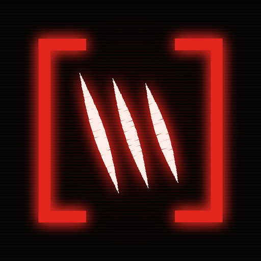
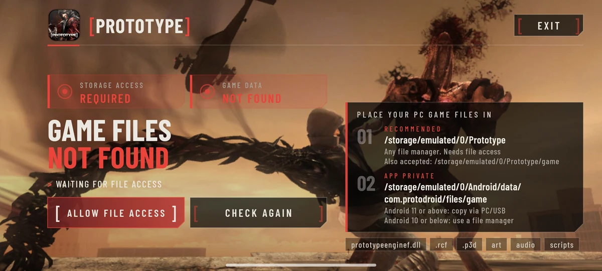
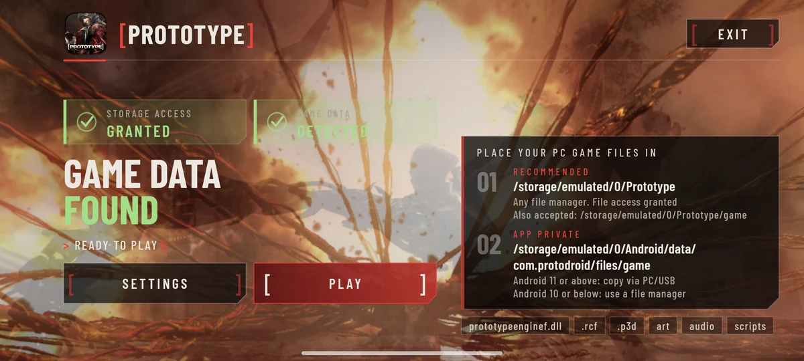
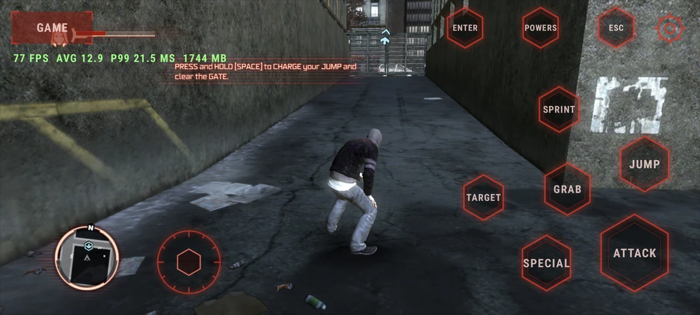
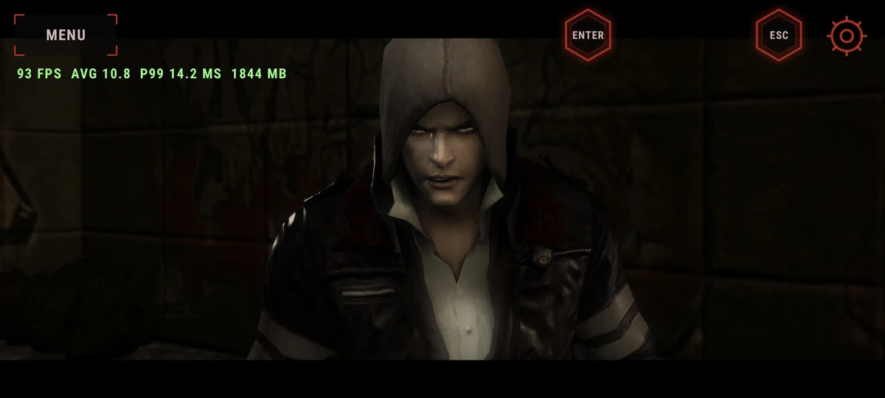

<div align="center">
  
  <h1>[ PROTODROID ]</h1>
  <p><strong>Prototype (2009), running natively on Android.</strong></p>
  <p>The original engine rebuilt for ARM64. No Wine. No full x86 emulator.</p>
  <p>
    <a href="https://github.com/Nazatric/ProtoDroid/releases/latest">Download</a> ·
    <a href="#get-playing">Get playing</a> ·
    <a href="#-screens-">Screenshots</a> ·
    <a href="#configuration">Settings</a> ·
    <a href="#building">Build</a>
  </p>
</div>

> **Bring your own game.** You need a legally obtained PC copy of **Prototype (2009)**. The APK contains the port, not the game data. The Android application ID is **`com.protodroid`**.

## Get playing

### What you need

- An **ARM64 Android device** with working Vulkan support. Android 10 or newer is recommended.
- **Prototype (2009)** on PC: Steam app **10150**, build **19788432**.
- Enough storage for the game files, shader cache, and logs.

### Install and play

1. Install `prototype.apk` and open **Prototype**.
2. Copy your PC game files to one of these folders:
   - **Recommended:** `/storage/emulated/0/Prototype/`
   - **Also supported:** `/storage/emulated/0/Prototype/game/`
   - **App-specific:** `/storage/emulated/0/Android/data/com.protodroid/files/game/`
3. Make sure the folder contains `prototypeenginef.dll` and the original archives and game folders. Grant file access if you use shared storage.
4. Return to the launcher and tap **Check Again** if needed. When your game is detected, tap **Play**.

On Android 11 or above, copy to the app-specific `Android/data` folder from a PC over USB. On Android 10 or below, a file manager with storage access also works. You do not need to keep two copies of the game.

## [ SCREENS ]

<p align="center"><strong>[ 01 // SETUP ] File Access</strong></p>


<p align="center"><strong>[ 02 // LAUNCHER ] Ready to Play</strong></p>


<p align="center"><strong>[ 03 // GAMEPLAY ] Touch Controls</strong></p>


<p align="center"><strong>[ 04 // MOVIES ] Bink Playback</strong></p>


## What’s inside

| Area | What you get |
| --- | --- |
| **Graphics** | The original renderer through D3D9 and DXVK, with resolution, texture, anisotropy, AA, shadow, and game-quality settings. Mali and Adreno receive device-specific compatibility handling without a shared visual downgrade. |
| **Movies and audio** | Full-screen Bink videos, ambient menu movies, RCF-resident files, and XAudio2 through FAudio. **Unlock menu FPS** is on by default. |
| **Controls** | Touch controls, absolute menu clicks, camera movement, action buttons, power wheels, and gamepad support. Button size, opacity, layout, vibration, camera speed, and extra actions are adjustable. |
| **Performance** | ARM64 hot-path replacements, optimized DXT decoding, stable FIFO presentation, ADPF hints, unrestricted CPU scheduling, and persistent DXVK state caching. |
| **Saves** | Shared profiles and saves that you can back up, replace, or delete with a file manager. Existing saves migrate without being overwritten. |

## Launcher and in-game settings

The launcher’s **Settings** page and the in-game gear menu share the same preferences. Changes made in the launcher are saved automatically; engine options are applied when you press **Play**. In-game rows marked with `*` take effect after a restart, while the FPS limit changes immediately.

- **Graphics:** Resolution, Textures, Anisotropy, FPS limit, Battery saver, and Unlock menu FPS.
- **Game Video:** Anti-Alias Level, Shadow Detail, and Graphic Quality. **Game default** leaves the engine’s own device-dependent choice intact.
- **Controls:** Button size, Vibration, Hide with gamepad, Stick edge sprint, Camera speed, Invert Y, and Extra buttons.
- **Interface:** Opacity and Show FPS.

**Low, Medium, and High presets** update only the graphics and game-video options. Your FPS and control preferences stay as they are. Choose **Custom** after changing an individual graphics row.

Use **LAYOUT** to drag controls into place, resize them, or reset the layout.

## Saves and profiles

With shared file access granted, saves and profiles live in:

```text
/storage/emulated/0/Prototype/Saves/
```

The game reads and writes files such as `profile.bin` and `slot-*.bin` there. You can add, replace, back up, or delete them with a file manager.

On the first run, ProtoDroid migrates saves from the old shared `/storage/emulated/0/Prototype/` location and the legacy app-specific folder. It never overwrites files already in `Saves`, and migration runs only once, so deleting a save does not bring an old copy back. Previous files remain as backups. If shared storage is unavailable, the app-specific save folder is still used.

## Configuration

Most options are available in the UI. For advanced settings, copy [`android/protodroid.ini.example`](android/protodroid.ini.example) to one of these locations:

- `/storage/emulated/0/Prototype/protodroid.ini`
- `/storage/emulated/0/Prototype/game/protodroid.ini`
- `/storage/emulated/0/Android/data/com.protodroid/files/protodroid.ini`
- The detected game folder or its parent folder

Keys use `key = value` syntax. You can also set `PROTODROID_<KEY>` in uppercase as an environment variable; environment values take priority.

| Key | What it does |
| --- | --- |
| `render_height` | Internal render height. Android defaults to 720; width follows the display aspect ratio. |
| `texture_skip_mips` | `0` full textures, `1` half resolution, `2` quarter resolution. |
| `texture_skip_min_size` | Minimum texture size eligible for mip reduction. |
| `max_anisotropy` | Texture anisotropy: 1, 2, 4, 8, or another supported value. |
| `fps_limit` | Host frame limit: `0`/off, 30, 45, or 60. |
| `battery_saver` | Enables the battery-saving frame policy. |
| `unlock_menu_fps` | `1` keeps menu movies responsive without blocking waits. Default: `1`. |
| `audio_driver` | `aaudio` or `openslES`. |
| `audio_master_reuse` | Reuses the retained mastering output when voices are recreated. |
| `vulkan_driver` | `auto`, `system`, or `turnip`. |
| `present_stats` | Enables DXVK presentation diagnostics. |
| `audio_stats` | `1` logs real underruns, `2` logs every timing window, `0` disables audio diagnostics. |
| `detailed_diagnostics` | `1` enables detailed native/device timing. Default: `0`; shared log mirroring still works. |
| `detailed_diagnostics_interval` | Diagnostic interval from 1–60 seconds. Default: `5`. |
| `pipeline_timing` | Lightweight DXVK pipeline timing; follows `detailed_diagnostics` unless set separately. |
| `pipeline_trace` | Expensive Mali pipeline tracing and shader dumps. Debugging only. |
| `dxvk_config` | Extra DXVK options, separated by commas in this file. |
| `import_profile` | `1` profiles guest and Win32/D3D9 wall time per thread every ten seconds. |
| `watchdog` | Enables hang diagnostics. |

Android presentation is fixed to **FIFO, interval 1** for both device creation and reset. An explicit FPS cap uses the host limiter; unlimited mode leaves pacing to FIFO. Desktop builds retain the optional presentation-mode settings.

## Logs and shader cache

Depending on storage access, logs are available in:

- `/storage/emulated/0/Android/data/com.protodroid/files/`
- `/storage/emulated/0/Prototype/logs/`

| File | Purpose |
| --- | --- |
| `proto-native.log` | Current native and engine run, including the exact CI source revision. |
| `proto-native.prev.log` | Previous native run. |
| `app_process64_d3d9.log` | DXVK and Vulkan messages. |
| `prototypeenginef.dll.dxvk-cache` | Persistent pipeline state cache. |
| `turnip_failed` | Present only after a Turnip initialization failure. |

For stall investigations, enable:

```ini
detailed_diagnostics = 1
import_profile = 1
```

Detailed reports include frame and engine timing, worst events, texture and file I/O, CPU threads, memory, ADPF, and thermal information where Android provides it. Use profiling to find a problem—not as an FPS benchmark. Leave these options off for ordinary play.

No cache seed is bundled. Startup can recover a populated cache from the shared or app-specific backup locations without replacing a valid private cache. DXVK validates the entries and compiles cached pipeline states as the corresponding game shaders become available; it cannot know variants that have never been encountered.

Backups are copied periodically without blocking the engine thread, with a synchronous final copy during shutdown. Atomic replacement keeps an interrupted backup from truncating the previous one. The live writer stays in app-private storage; the shared copy is a recovery backup, not a power-loss-durability guarantee.

For bug reports, include both logs, your phone model, SoC/GPU, Android version, APK commit, and exact reproduction steps. If you have ADB access, also include `adb logcat -s protodroid`.

## Under the hood

- **Static ARM64 recompilation:** `prototypeenginef.dll` is translated from 32-bit x86 into C and compiled for Android. The runtime supplies guest memory, x86-like memory ordering, threads, fibers, and the Microsoft CRT behavior the engine expects.
- **A native Win32 and input bridge:** ProtoDroid implements the Win32, DirectInput 8, XAudio2 2.3, Bink 1.9, and launcher interfaces used by the game rather than shipping Wine.
- **D3D9 on Vulkan:** a generated bridge forwards drawing to DXVK. Android patches cover Mali and Adreno behavior, descriptor compatibility, pipeline compilation, presentation, and persistent caching.
- **Bink through FFmpeg:** a minimal FFmpeg build decodes loose and RCF-resident movies. Decoded YUV planes are copied directly into the textures supplied by the game.
- **XAudio2 through FAudio:** FAudio handles voice processing and mixing, with SDL audio output and Android-friendly pacing.
- **SDL2 and Android UI:** SDL owns the window and platform events. A native Android layer provides the launcher, touch controls, gamepad support, layout editor, and settings.

## Building

You need a Linux environment with the Android SDK/NDK, JDK, SDK build-tools, CMake, Ninja, Meson, Python 3, `capstone`, and `pefile`. Turnip also needs the tools listed in `android/build-turnip.sh`.

Set `PROTODROID_ENGINE` to your original `prototypeenginef.dll` when it is not in the default location. The engine must be generated for base `0x7c000000`, matching `src/native/guest.h`.

```sh
# Build SDL2, FAudio, minimal FFmpeg, and patched DXVK.
android/build-deps.sh arm64-v8a \
  "$HOME/protodroid-data/android-deps-src" \
  "$HOME/protodroid-data/android-deps/arm64-v8a"

# Optional: build Turnip for Adreno.
android/build-turnip.sh \
  "$HOME/protodroid-data/android-deps-src" \
  "$HOME/protodroid-data/android-turnip"

# Generate the ARM64-bound engine sources.
python3 -I tools/recomp/data_entries.py
python3 -I tools/recomp/recomp.py \
  --functions all --base 0x7c000000 --split 400 \
  --out build/recomp/native

# Build the primary ARMv8.2 native library.
tools/cool_make.sh -C src/native PLATFORM=android ABI=arm64-v8a

# Build the ARMv8.0 compatibility library for older cores.
tools/cool_make.sh -C src/native PLATFORM=android ABI=arm64-v8a \
  ARM_ARCH=armv8-a OUT=../../build/android/arm64-v8a-v80

# Package, zipalign, sign, and verify build/apk/prototype.apk.
android/build-apk.sh arm64-v8a
```

`tools/cool_make.sh` runs a parallel build and pauses when the host reaches its configured temperature limit. Ordinary `make` with the same variables works too. Local native builds record the checked-out Git commit when available; CI embeds the exact workflow commit and verifies it before a release.

## Tests

Host tests use strict warnings and UndefinedBehaviorSanitizer. They cover DXT decoding, sampler and lock rules, presentation normalization, save paths and migration, state-cache behavior, settings, and version increments.

```sh
# Graphics helpers and DXT differential tests.
g++ -std=c++17 -O1 -g -Wall -Wextra -Werror \
  -fsanitize=undefined -fno-sanitize-recover=all -Isrc/native \
  src/native/d3d9_dxt.cpp src/native/tests/graphics_test.cpp \
  -o /tmp/graphics_test
UBSAN_OPTIONS=print_stacktrace=1:halt_on_error=1 /tmp/graphics_test
```

The production Bink harness and minimal FFmpeg setup run in `.github/workflows/build-apk.yml`. `src/native/tests/run_hot_test.sh` performs the audio and skinning differential tests and requires the original engine binary. CI runs those tests on ARM64, including 2,000 randomized skinning batches with different record counts and output alignments.

## Launcher updates

The launcher checks the latest published GitHub release in the background and compares its integer `versionCode`, not just the visible version string. An update card appears only for a newer release with the official `prototype.apk`, release APK SHA-256, and signing-certificate metadata. Downloads use Android's system DownloadManager, show progress, and are checked against the release hash and APK package/version before installation is offered.

- **Same signing certificate:** Android opens the normal in-place installer.
- **Different signing certificate:** the launcher explains why Android requires uninstalling the old copy first, then chains the system uninstall and install prompts where the device permits it. Shared game saves and files under `/storage/emulated/0/Prototype` are not deleted. App-private settings and data may be removed, so back up anything important outside that shared folder.
- **If Android closes ProtoDroid during uninstall:** open the completed ProtoDroid download notification or the APK in the public **Downloads** folder to continue. This fallback is intentional: an ordinary app cannot silently uninstall itself and guarantee that it can launch another activity afterward.

The updater never downloads game content, changes graphics or controls, or installs an unverified APK. Automatic checks are rate-limited and failures do not block Play.

## CI and releases

- **`build-apk`** runs host and ARM64 tests, builds dependencies, generates and compiles the real engine, packages and signs the APK, and uploads `prototype-apk` with diagnostic artifacts.
- **`android-deps`** independently builds the ARM64 and x86_64 dependency sets and the Adreno Turnip package.

Ordinary pushes do not publish releases. A release requires an exact-commit green run on `main` and an explicitly approved release dispatch. The workflow rejects dummy or prebuilt native fallbacks, mismatched source revisions, reused versions, and out-of-order `versionCode` values.

`android/AndroidManifest.xml` is the version source of truth. Before an approved release cycle, run `python3 tools/bump_version.py` once and commit it with the matching `CHANGELOG.md` entry. The tool advances the visible version and integer `versionCode` together.

A green CI run is not a substitute for playing on a real device. Graphics, movies, controls, saves, and update behavior still need on-device validation.

### Signing and in-place updates

Local packaging uses the Android debug keystore by default. Set `KEYSTORE`, `KEYSTORE_PASS`, `KEY_ALIAS`, and optionally `KEY_PASS` to use another identity. `KEY_PASS` defaults to the store password; JKS also supports a separate key password.

Protected releases use these repository Actions secrets:

- `PROTODROID_ANDROID_KEYSTORE_BASE64`
- `PROTODROID_ANDROID_KEYSTORE_PASSWORD`
- `PROTODROID_ANDROID_KEY_ALIAS`
- `PROTODROID_ANDROID_KEY_PASSWORD`

Encode the keystore with `base64 -w 0` on Linux or `base64` without line wrapping on macOS. Keep an offline backup of the original keystore and passwords, and never commit them. Once protected signing is configured, later releases keep the same identity and can update in place.

Branch and PR artifacts use disposable CI identities and are not release-eligible. Ephemeral releases are rejected unless explicitly approved. Some existing builds, including 0.8 and older CI artifacts, use certificates whose private keys are unavailable. Android cannot install a differently signed build over them; a one-time uninstall is required. Shared saves under `/storage/emulated/0/Prototype` remain separate from the app, but back up any important app-specific data first.

## Credits and legal

Original Android port and recompilation research by **[VinTeRuS](https://github.com/VinTeRuS)**. ProtoDroid continues with contributions from the community.

Prototype is a trademark of its respective owners and was developed by Radical Entertainment. This project is not affiliated with or endorsed by Activision or Radical Entertainment. Provide your own game files; no DRM bypass is included.
