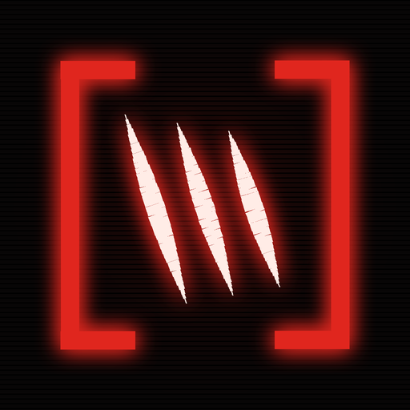
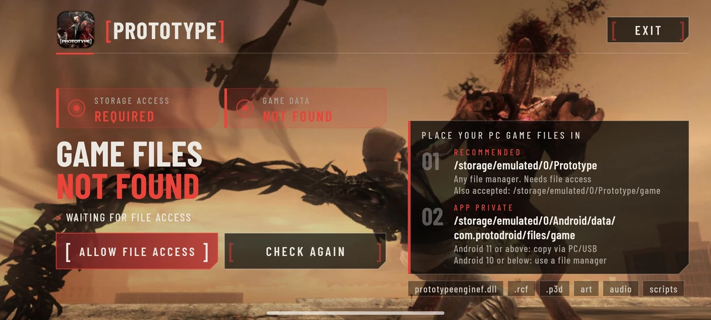
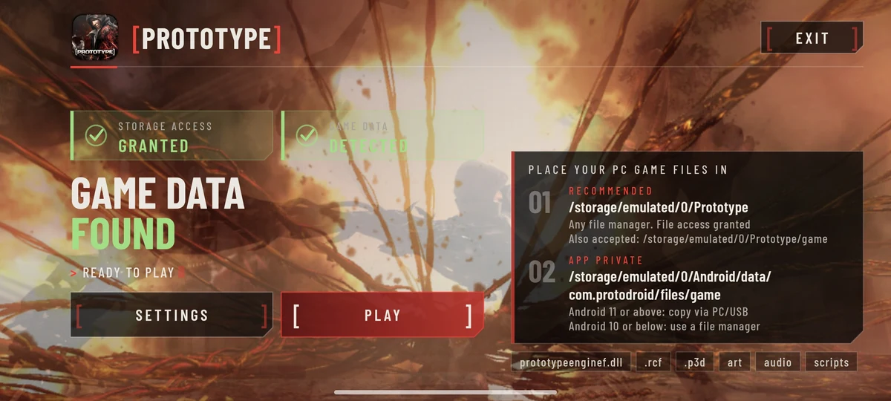
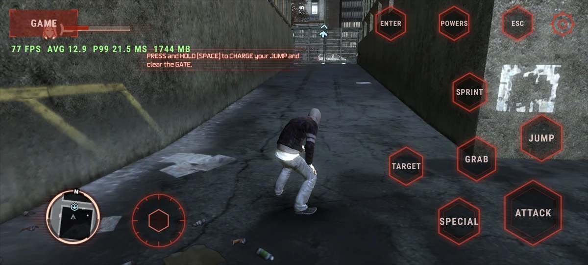
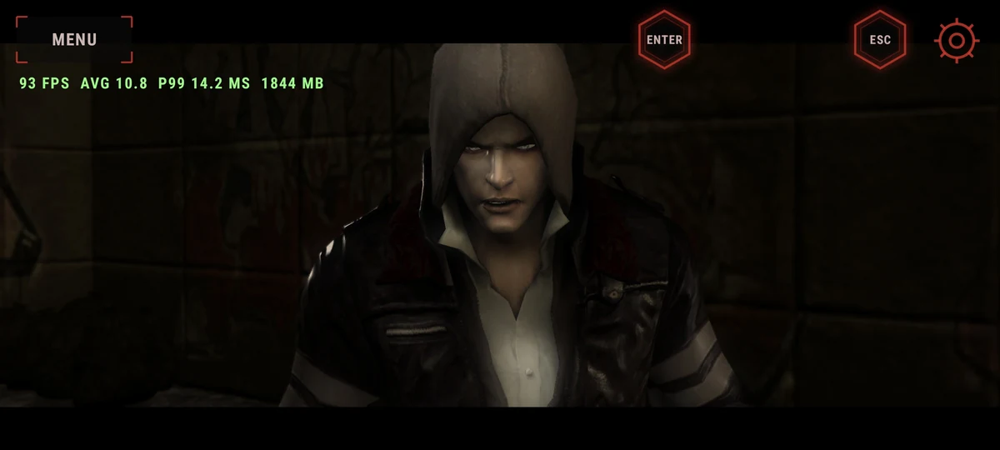

<div align="center">
  
  <h1>[ PROTODROID ]</h1>
  <p><strong>PROTOTYPE (2009) // NATIVELY ON ANDROID</strong></p>
  <p>The original engine, statically rebuilt for ARM64.<br>No Wine. No full x86 emulator.</p>
  <p>
    <a href="https://github.com/Nazatric/ProtoDroid/releases/latest"></a>
    <a href="https://github.com/Nazatric/ProtoDroid/actions/workflows/build-apk.yml"></a>
    
  </p>
  <p>
    <a href="https://github.com/Nazatric/ProtoDroid/releases/latest"><strong>DOWNLOAD</strong></a> ·
    <a href="#quick-start">QUICK START</a> ·
    <a href="#screens">SCREENS</a> ·
    <a href="#settings-and-drivers">SETTINGS</a> ·
    <a href="#mods-and-engine-fixes">MODS</a> ·
    <a href="#logs-and-diagnostics">LOGS</a> ·
    <a href="CHANGELOG.md">CHANGELOG</a>
  </p>
</div>

> [!IMPORTANT]
> **Bring your own game.** You need a legally obtained PC copy of **Prototype (2009)**. The APK contains the port, not the game data. The Android application ID is **`com.protodroid`**.

## Quick start

| Requirement | Details |
| --- | --- |
| **Device** | ARM64 Android with working Vulkan support. Android 10 or newer is recommended. |
| **Game** | Prototype (2009) on PC: Steam app **10150**, build **19788432**. |
| **Storage** | Enough space for the game files, shader cache, and logs. |

1. Download `prototype.apk` from the [latest release](https://github.com/Nazatric/ProtoDroid/releases/latest), install it, and open **Prototype**.
2. Copy your PC game files into **one** of these folders:

   | Location | Folder |
   | --- | --- |
   | **Recommended** | `/storage/emulated/0/Prototype/` |
   | **Also supported** | `/storage/emulated/0/Prototype/game/` |
   | **App-specific** | `/storage/emulated/0/Android/data/com.protodroid/files/game/` |

3. Keep the original file names and layout. The folder must contain:
   - `prototypeenginef.dll` and `proto_uv.dat` — **both are required for startup**.
   - The original `.rcf` and `.p3d` archives.
   - The `art/`, `audio/`, and `scripts/` folders.
4. Grant file access if you use shared storage. Return to the launcher, tap **Check Again** if needed, then tap **Play**.

On Android 11 or above, copy to the app-specific `Android/data` folder from a PC over USB. On Android 10 or below, a file manager with storage access also works. You do not need to keep two copies of the game.

## Screens

| [ 01 // SETUP ] | [ 02 // LAUNCHER ] |
| :---: | :---: |
|  |  |
| File access and game-data detection | Ready to play |

| [ 03 // GAMEPLAY ] | [ 04 // MOVIES ] |
| :---: | :---: |
|  |  |
| Touch controls and performance overlay | Bink video playback |

## What’s inside

| Area | What you get |
| --- | --- |
| **Graphics** | The original renderer through D3D9 and DXVK, with resolution, texture, anisotropy, AA, shadow, and game-quality settings. Mali and Adreno receive device-specific compatibility handling without a shared visual downgrade. |
| **Movies and audio** | Full-screen Bink videos, ambient menu movies, RCF-resident files, and XAudio2 through FAudio. **Unlock menu FPS** is on by default. |
| **Controls** | Touch controls, absolute menu clicks, camera movement, action buttons, power wheels, helicopter descend, a numbered 1–4 pad, Android keyboard input, and gamepad support. Button size, opacity, layout, vibration, camera speed, and extra actions are adjustable. |
| **Performance** | ARM64 hot-path replacements, optimized DXT decoding, stable FIFO presentation, ADPF hints, unrestricted CPU scheduling, and persistent DXVK state caching. |
| **Saves** | Shared profiles and saves that you can back up, replace, or delete with a file manager. Existing saves migrate without being overwritten. |
| **Mods** | An optional local library for overlays, large keyed texture packs, sandboxed Lua engine scripts, and independently rebuilt ARM64 plugins, with dependencies, author options, and next-Play activation. |

## Settings and drivers

The launcher’s **Settings** page keeps graphics, drivers, and engine policies. Its rows show short explanations on touch, hover, or keyboard focus; changes save automatically and engine options apply on **Play**. The in-game gear is a smaller live panel: FPS/battery/menu pacing, touch controls, FPS overlay, and **Layout**. Restart-only graphics and engine/mod experiments stay out of that panel.

- **Graphics:** Resolution, Textures, DXT1 color, Anisotropy, FPS limit, Battery saver, Unlock menu FPS, and GPU driver.
- **Game Video:** Anti-Alias Level, Shadow Detail, and Graphic Quality. **FXAA** filters the completed frame with built-in MSAA disabled to avoid Prototype’s missing-texture AA path; **2x/4x MSAA** retain the original behavior. **Game default** leaves the engine’s own device-dependent choice intact.
- **Controls:** Button size, Vibration, Hide with gamepad, Stick edge sprint, Camera speed, Invert Y, and Extra buttons. **ABC** opens a compact in-game PC keyboard with a full 104-key mode. The layout editor adds movable one- or two-key buttons with rebind, hide, and remove actions. **123** toggles number keys and **DESCEND** sends `V`.
- **Interface:** Screen orientation, Opacity, and Show FPS. Fixed Landscape/Reverse is an optional recovery for devices that choose the wrong direction; Auto remains the default.
- **Engine fixes:** Optional FOV, shadow-map, tick/QTE, loose-file, developer-menu, VRAM-report, and texture-dump policies. Safe defaults remain unchanged until you opt in.

**Low, Medium, and High presets** update only the graphics and game-video options. Medium/High use FXAA; High keeps full 32-bit decoded DXT1 color, while Low/Medium retain the lower-bandwidth 16-bit path. Exact old Medium/High AA preset values migrate to FXAA once; Custom and explicit MSAA choices are preserved. Your FPS and control preferences stay as they are. Choose **Custom** after changing an individual graphics row. Use **LAYOUT** to drag controls into place, resize them, or reset the layout.

### Mods and engine fixes

Open **Mods** beside **Drivers** to import a local ZIP, a loose file, a Lua package, or an ARM64 `.so`. The library shows installed/active counts, cover art, descriptions, content types, dependency/compatibility errors, and load state. Imports start **disabled**; review the details, then enable them for the next **Play**. Mods with author-defined options have **Configure** for toggles, stepped sliders, choices, and text, with reset/discard handling. Enable/disable, two-step removal, and executable-code confirmation never patch original game files or shared saves. Engine fixes remain in Settings, not Mods.

Packages live under `/storage/emulated/0/Prototype/mods/` when shared access is available, or ProtoDroid’s app-specific `mods/` folder otherwise. A ZIP can use the documented manifest or a legacy layout, including one top-level wrapper folder. API-2 packages add dependency-ordered Lua scripting and native ABI-v3 symbols/events; existing ABI-v1/v2 plugins retain their contracts. Lua states have restricted libraries and memory/instruction limits, but engine calls and memory writes still require trusted code. **Windows x86 ASI/DLL plugins do not load on Android**; native plugins must be independently translated and rebuilt for AArch64.

Texture packs map ProtoDroid’s versioned texture hashes in `textures.ini` to same-size, same-format DDS replacements. Large projects use bounded imports and lazy per-mip reads rather than retaining every payload in memory. Enable **Dump original textures** to create original-format DDS files and a starter mapping. This supports compatible static 2D replacements, including character textures when they use the supported path—not arbitrary high-resolution resizing or new engine effects. See the [authoring guide](modding/README.md) and [platform contract](re/native-mod-platform.md).

The **Engine fixes** tab exposes fractional FOV offsets through INI, 512–8192 shadow-map limits, the evidenced tick/QTE policies, loose files, the guarded developer-menu option, DXVK VRAM reporting, and texture dumping. Higher limits can cost memory and performance; support and appearance remain device-dependent. These options are independent of imported mods.

### Vulkan drivers

| Mode | Behavior |
| --- | --- |
| **Auto** | The default. Keeps the established Adreno 6xx/7xx order and uses a dedicated Gen8 Turnip build for Adreno 825 (SM8735). Other Adreno 8xx models keep the system driver unless you explicitly opt in. |
| **System** | Always uses the phone’s Vulkan driver. |
| **Turnip** | Adreno-only. Falls back to System on Mali rather than pretending to be a Mali driver. |
| **Custom** | Uses the explicitly selected, validated package from the Drivers library. |

If the direct system path cannot run DXVK, Auto can try a bundled Vulkan 1.1 compatibility wrapper after an isolated feature probe. The wrapper advertises its lowered DXVK-facing 1.3 interface only after requesting Mesa’s real compatibility path; missing features or extensions still reject it. Working direct Vulkan 1.2/1.3 paths and explicit driver choices are not replaced. Physical Mali and PowerVR compatibility remains unverified.

Open **Drivers** on the launcher or beside **Done** in Settings for the guided driver screen. Your current choice appears first, followed by large plain-language mode cards. **Driver packages** is a separate optional section with **Installed** and **Downloads** tabs, so ordinary Auto/System use is not buried in advanced controls. Downloads start with packages for the detected GPU family and offer **Show all**; this is only a compatibility filter, not a device guarantee. Tap an installed card to use it, open **Details** for technical information, or use two-tap **Remove**.

Download pinned standard Turnip, Samsung One UI Turnip, Gen8 Turnip, or experimental PanVK-kbase packages from their identified GitHub releases, or import an AdrenoTools/.adpkg ZIP or raw `.so`. Downloads show progress and exact SHA-256 verification; installing one never silently changes Auto into Custom. Packages are private to ProtoDroid, validated as Android/Bionic ARM64, staged before replacement, and tested in a separate process on the next Play. Custom loading requires Android 10 or newer.

PanVK-kbase is loaded through its direct Vulkan ICD entry point, with the same probe and mapped-library checks in the probe and game. It supports only specific Mali generations and the retail `mali_kbase` interface—not every Mali GPU, kernel, or game. ProtoDroid selects its exact BC path rather than optional lossy texture modes. A failed probe uses System. Auto also records a selected driver’s startup crash or clean D3D9 initialization failure so the next launch can try System; explicit Turnip/Custom choices remain explicit. A probe or CI build cannot prove every later frame or device. Return to **Auto** or **System** and include the native/DXVK logs in a report.

## Saves and profiles

With shared file access granted, saves and profiles live in:

```text
/storage/emulated/0/Prototype/Saves/
```

The game reads and writes files such as `profile.bin` and `slot-*.bin` there. You can add, replace, back up, or delete them with a file manager.

On the first run, ProtoDroid migrates saves from the old shared `/storage/emulated/0/Prototype/` location and the legacy app-specific folder. It never overwrites files already in `Saves`, and migration runs only once, so deleting a save does not bring an old copy back. Previous files remain as backups. If shared storage is unavailable, the app-specific save folder is still used.

## Configuration

Most options are available in the UI. For advanced settings, copy [`android/protodroid.ini.example`](android/protodroid.ini.example) to one of these locations:

- `/storage/emulated/0/Prototype/protodroid.ini`
- `/storage/emulated/0/Prototype/game/protodroid.ini`
- `/storage/emulated/0/Android/data/com.protodroid/files/protodroid.ini`
- The detected game folder or its parent folder

Keys use `key = value` syntax. You can also set `PROTODROID_<KEY>` in uppercase as an environment variable; environment values take priority.

<details>
<summary><strong>Advanced INI keys and presentation behavior</strong></summary>

| Key | What it does |
| --- | --- |
| `render_height` | Internal render height. Android defaults to 720; width follows the display aspect ratio. |
| `texture_skip_mips` | `0` full textures, `1` half resolution, `2` quarter resolution. |
| `texture_skip_min_size` | Minimum texture size eligible for mip reduction. |
| `decode_16bit` | On decoded DXT1 textures, `0` keeps full 32-bit color and `1` uses the lower-bandwidth 16-bit path. |
| `max_anisotropy` | Texture anisotropy: 1, 2, 4, 8, or another supported value. |
| `game_aa_level` | `-1` Game default, `0` Off, `1` 2x MSAA, `2` 4x MSAA, `3` FXAA. FXAA keeps GameDB/present MSAA at zero and applies on the next Play. |
| `fps_limit` | Host frame limit: `0` disables it; positive values use the existing limiter. The UI offers 30–1000, without promising the resulting frame rate. |
| `battery_saver` | Enables the battery-saving frame policy. |
| `unlock_menu_fps` | `1` keeps menu movies responsive without blocking waits. Default: `1`. |
| `audio_driver` | `aaudio` or `openslES`. |
| `audio_master_reuse` | Reuses the retained mastering output when voices are recreated. |
| `vulkan_driver` | `auto`, `system`, `turnip`, or `custom`; Custom uses the explicitly selected validated package in the Drivers library. |
| `present_stats` | Enables DXVK presentation diagnostics. |
| `audio_stats` | `1` logs real underruns, `2` logs every timing window, `0` disables audio diagnostics. |
| `detailed_diagnostics` | `1` enables detailed native/device timing. Default: `0`; shared log mirroring still works. |
| `detailed_diagnostics_interval` | Diagnostic interval from 1–60 seconds. Default: `5`. |
| `pipeline_timing` | Lightweight DXVK pipeline timing; follows `detailed_diagnostics` unless set separately. |
| `pipeline_trace` | Expensive Mali pipeline tracing and shader dumps. Debugging only. |
| `dxvk_config` | Extra DXVK options, separated by commas in this file. |
| `import_profile` | `1` profiles guest and Win32/D3D9 wall time per thread every ten seconds. |
| `watchdog` | Enables hang diagnostics. |

Android presentation is fixed to **FIFO, interval 1** for both device creation and reset. An explicit FPS cap uses the host limiter; unlimited mode leaves pacing to FIFO. Desktop builds retain the optional presentation-mode settings. DXVK’s official Prototype DF-format workaround is applied explicitly because the native host does not use the `prototypef.exe` process name; graphics-quality settings are unchanged.

</details>

## Logs and diagnostics

Depending on storage access, logs are available in:

- `/storage/emulated/0/Android/data/com.protodroid/files/`
- `/storage/emulated/0/Prototype/logs/`

| File | Purpose |
| --- | --- |
| `proto-native.log` | Current native and engine run, including the exact CI source revision. |
| `proto-native.prev.log` | Previous native run. |
| `app_process64_d3d9.log` | DXVK and Vulkan messages. |
| `prototypeenginef.dll.dxvk-cache` | Persistent pipeline state cache. |
| `turnip_failed` | Crash/initialization-failure marker for an unconfirmed custom/bundled driver startup; explicit selection retries it. |

### Diagnostic tour

Type **MERCER** on the launcher or tap its Prototype logo seven times quickly, then choose **START TOUR**. Repeat the code/gesture to disarm it. The 22-phase plan requests a direct test level, then rapidly exercises movement, camera, jumping/sprinting, targeting, combat, grab follow-ups, quick powers, power/disguise wheels, disguise-form inputs, shadows, effects, streaming, audio, and recovery without further interaction.

Tour saves, logs, and shader cache are isolated from normal Play. Shared results are under `/storage/emulated/0/Prototype/diagnostic-tour/logs/`, including `journal.log`, `phase.txt`, `result.txt`, and `crash.log`. Every non-skipped phase requires rendered dwell and continuing `InGameState` task activity; presents alone are not enough. Coalesced Presents do not compress logical action frames. Phases record exact actions, wall/process-CPU time, gameplay dispatches, and Presented frames, with rolling timing snapshots. Duplicate sync/logging work is reduced without shortening the plan. “Tested” means those inputs and activity completed—not visual, ability-result, or audio verification. Bink and physical-touch phases remain explicit skips. The isolated process closes intentionally at completion or failure.

### Detailed profiling

For stall investigations, enable:

```ini
detailed_diagnostics = 1
import_profile = 1
```

Detailed reports include frame and engine timing, worst events, texture and file I/O, CPU threads, memory, ADPF, and thermal information where Android provides it. Use profiling to find a problem—not as an FPS benchmark. Leave these options off for ordinary play.

<details>
<summary><strong>Shader-cache recovery and durability</strong></summary>

No cache seed is bundled. Startup can recover a populated cache from the shared or app-specific backup locations without replacing a valid private cache. DXVK validates the entries and compiles cached pipeline states as the corresponding game shaders become available; it cannot know variants that have never been encountered.

Backups are copied periodically without blocking the engine thread, with a synchronous final copy during shutdown. Atomic replacement keeps an interrupted backup from truncating the previous one. The live writer stays in app-private storage; the shared copy is a recovery backup, not a power-loss-durability guarantee.

</details>

### Report a problem

Use the [guided issue forms](https://github.com/Nazatric/ProtoDroid/issues/new/choose) and choose bug, crash, performance, or feature. Include your phone model, SoC/GPU, Android version, exact APK version or commit, reproduction steps, and the available logs from the failed run. If you have ADB access, `adb logcat -s protodroid` can also help. Please do not attach game installation files, cache files, or save files.

## Updates

The launcher checks the latest published GitHub release and compares its integer `versionCode`. For an available update, **DOWNLOAD** opens that release’s GitHub page directly. **VERSIONS** always opens the [official release archive](https://github.com/Nazatric/ProtoDroid/releases) for older APKs; no third-party mirror is used. Recovery for an existing in-app download still verifies its APK hash, package/version, and signing certificate before offering installation.

- **Same certificate:** Android can update in place.
- **Different certificate:** Android requires a one-time uninstall first. Shared saves and files under `/storage/emulated/0/Prototype` are separate; back up important app-private data.
- **If Android closes ProtoDroid during an existing verified-download uninstall:** open its completed download notification or the APK in Downloads.

Automatic checks use a 15-minute backoff and do not block Play. Update errors offer Retry and **ALL VERSIONS**. Older APKs use the signing rules above; back up important data before reinstalling a different certificate.

## Under the hood

- **Static ARM64 recompilation:** `prototypeenginef.dll` is translated from 32-bit x86 into C and compiled for Android. The runtime supplies guest memory, x86-like memory ordering, threads, fibers, and the Microsoft CRT behavior the engine expects.
- **A native Win32 and input bridge:** ProtoDroid implements the Win32, DirectInput 8, XAudio2 2.3, Bink 1.9, and launcher interfaces used by the game rather than shipping Wine.
- **D3D9 on Vulkan:** a generated bridge forwards drawing to DXVK 2.5.3. Android patches cover Mali and Adreno behavior, descriptor compatibility, pipeline compilation, presentation, and persistent caching.
- **Bink through FFmpeg:** a minimal FFmpeg build decodes loose and RCF-resident movies. Decoded YUV planes are copied directly into the textures supplied by the game.
- **XAudio2 through FAudio:** FAudio handles voice processing and mixing, with SDL audio output and Android-friendly pacing.
- **SDL2 and Android UI:** SDL owns the window and platform events. A native Android layer provides the launcher, touch controls, gamepad support, layout editor, and settings.

## Developer guide

<details>
<summary><strong>Build from source</strong></summary>

You need a Linux environment with the Android SDK/NDK, JDK, SDK build-tools, CMake, Ninja, Meson, Python 3, `capstone`, and `pefile`. Turnip also needs the tools listed in `android/build-turnip.sh`; the dependency script’s additional requirements are listed in `android/build-deps.sh`.

Set `PROTODROID_ENGINE` to your original `prototypeenginef.dll` when it is not in the default location. The engine must be generated for base `0x7c000000`, matching `src/native/guest.h`.

```sh
# Build SDL2, FAudio, minimal FFmpeg, patched DXVK, and the ARM64 Vulkan wrapper.
android/build-deps.sh arm64-v8a \
  "$HOME/protodroid-data/android-deps-src" \
  "$HOME/protodroid-data/android-deps/arm64-v8a"

# Build stable/next Turnip, patched A825 Gen8 Turnip, and AdrenoTools (required for ARM64 APKs).
android/build-turnip.sh \
  "$HOME/protodroid-data/android-deps-src" \
  "$HOME/protodroid-data/android-turnip"

# Generate the ARM64-bound engine sources.
python3 -I tools/recomp/data_entries.py
python3 -I tools/recomp/recomp.py \
  --functions all --base 0x7c000000 --split 400 \
  --out build/recomp/native

# Build the primary ARMv8.2 native library.
tools/cool_make.sh -C src/native PLATFORM=android ABI=arm64-v8a

# Build the ARMv8.0 compatibility library for older cores.
tools/cool_make.sh -C src/native PLATFORM=android ABI=arm64-v8a \
  ARM_ARCH=armv8-a OUT=../../build/android/arm64-v8a-v80

# Package, zipalign, sign, and verify build/apk/prototype.apk.
android/build-apk.sh arm64-v8a
```

`tools/cool_make.sh` runs a parallel build and pauses when the host reaches its configured temperature limit. Ordinary `make` with the same variables works too. Local native builds record the checked-out Git commit when available; CI embeds the exact workflow commit and verifies it before a release.

</details>

<details>
<summary><strong>Tests, CI, releases, and signing</strong></summary>

### Tests

Host tests use strict warnings and UndefinedBehaviorSanitizer. They cover DXT decoding, sampler and lock rules, presentation normalization, the Prototype DXVK profile, save paths and migration, game-file validation, diagnostic-tour planning and engine-thunk probes, state-cache behavior, updater recovery policy, settings, and version increments.

```sh
# Graphics helpers and DXT differential tests.
g++ -std=c++17 -O1 -g -Wall -Wextra -Werror \
  -fsanitize=undefined -fno-sanitize-recover=all -Isrc/native \
  src/native/d3d9_dxt.cpp src/native/tests/graphics_test.cpp \
  -o /tmp/graphics_test
UBSAN_OPTIONS=print_stacktrace=1:halt_on_error=1 /tmp/graphics_test
```

Run `android/test-driver-package.sh` with a JDK to test real staged driver imports, ELF/metadata validation, checksums, rollback, multi-package storage, and legacy/deduplication behavior on a host. CI also sets `DRIVER_CATALOG_ONLINE=1` to download and validate every pinned catalog asset and PanVK’s direct ICD export. The script fetches a pinned JSON-java source tree for tests only; Android provides `org.json` in the APK.

The production Bink harness and minimal FFmpeg setup run in `.github/workflows/build-apk.yml`. `src/native/tests/run_hot_test.sh` performs the audio and skinning differential tests and requires the original engine binary. CI runs those tests on ARM64, including 2,000 randomized skinning batches with different record counts and output alignments.

### CI and releases

- **`build-apk`** runs host and ARM64 tests, builds dependencies, the Vulkan compatibility wrapper, and all three Turnip variants, tests driver packages, generates and compiles the real engine, verifies the signed driver payload, and uploads `prototype-apk` with diagnostic artifacts.
- **`android-deps`** independently builds the ARM64 and x86_64 dependency sets and the Adreno Turnip package.

Ordinary pushes do not publish releases. A release requires an exact-commit green run on `main` and an explicitly approved release dispatch. The workflow rejects dummy or prebuilt native fallbacks, mismatched source revisions, reused versions, and out-of-order `versionCode` values.

`android/AndroidManifest.xml` is the version source of truth. Before an approved release cycle, run `python3 tools/bump_version.py` once and commit it with the matching `CHANGELOG.md` entry. The tool advances the visible version and integer `versionCode` together.

A green CI run is not a substitute for playing on a real device. Graphics, movies, controls, saves, and update behavior still need on-device validation.

### Signing and in-place updates

Local packaging uses the Android debug keystore by default. Set `KEYSTORE`, `KEYSTORE_PASS`, `KEY_ALIAS`, and optionally `KEY_PASS` to use another identity. `KEY_PASS` defaults to the store password; JKS also supports a separate key password.

Protected releases use these repository Actions secrets:

- `PROTODROID_ANDROID_KEYSTORE_BASE64`
- `PROTODROID_ANDROID_KEYSTORE_PASSWORD`
- `PROTODROID_ANDROID_KEY_ALIAS`
- `PROTODROID_ANDROID_KEY_PASSWORD`

Encode the keystore with `base64 -w 0` on Linux or `base64` without line wrapping on macOS. Keep an offline backup of the original keystore and passwords, and never commit them. Once protected signing is configured, later releases keep the same identity and can update in place.

Branch and PR artifacts use disposable CI identities and are not release-eligible. Disposable releases and certificate changes require separate explicit approvals; both approved dispatch types can use the same protected identity. The protected secrets and offline keystore backup must be maintained by a repository administrator.

**0.14’s disposable private key cannot be recovered.** A persistent 0.15 identity cannot match its certificate, so installation over 0.14 requires one uninstall even after persistent signing is configured. Later releases can update in place only while that identity is retained. Shared saves under `/storage/emulated/0/Prototype` remain separate, but back up important app-private data first.

</details>

## Credits and legal

Original Android port and recompilation research by **[VinTeRuS](https://github.com/VinTeRuS)**. ProtoDroid continues with contributions from the community.

Prototype is a trademark of its respective owners and was developed by Radical Entertainment. This project is not affiliated with or endorsed by Activision or Radical Entertainment. Provide your own game files; no DRM bypass is included.
